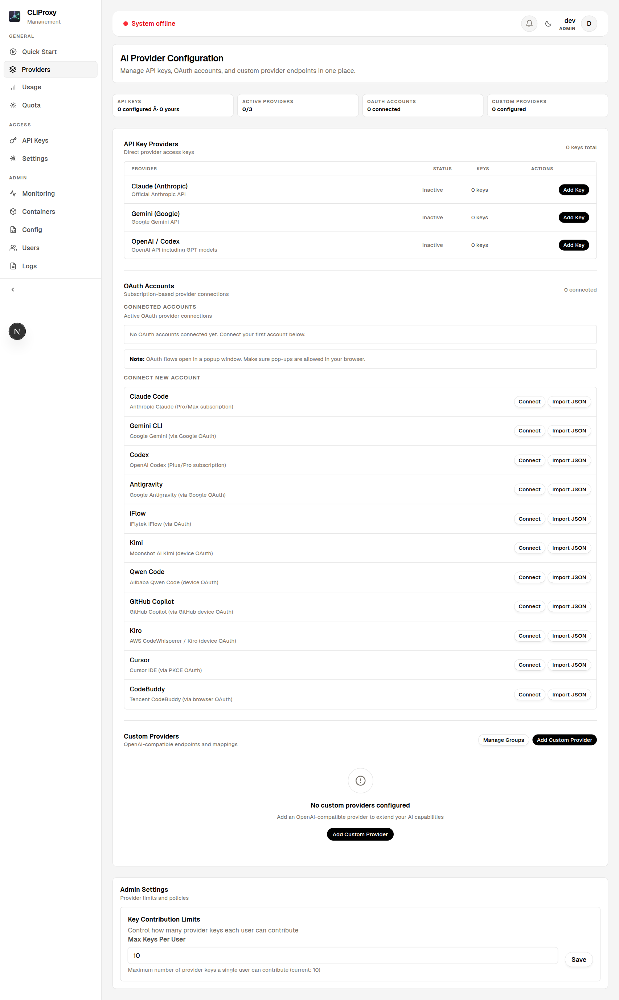
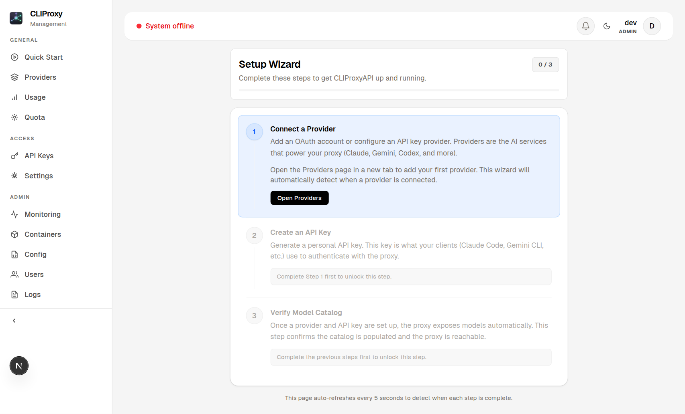
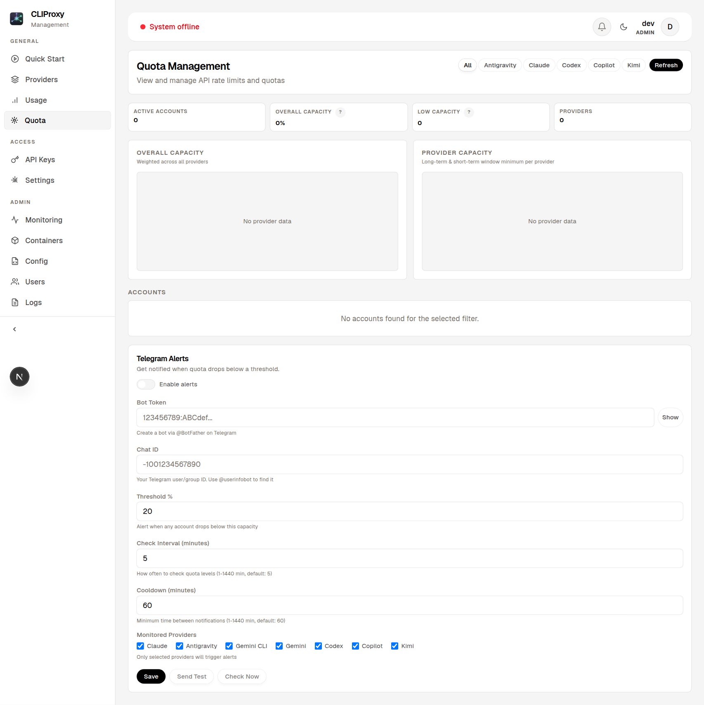
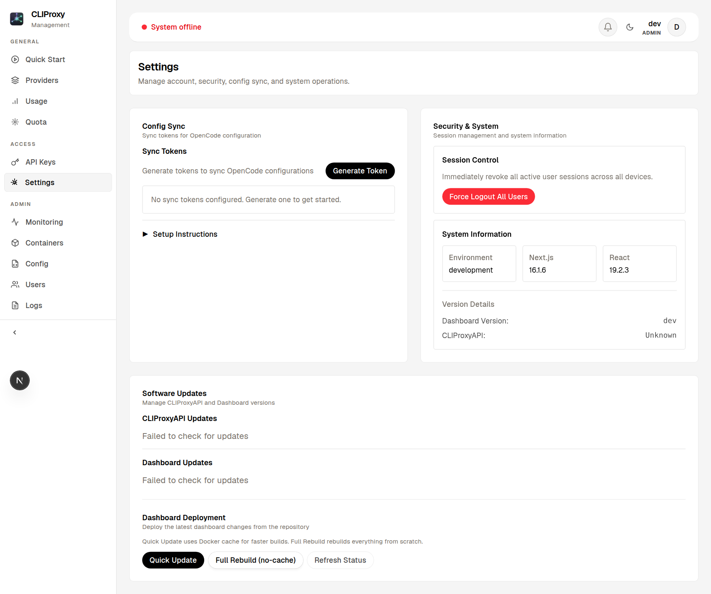
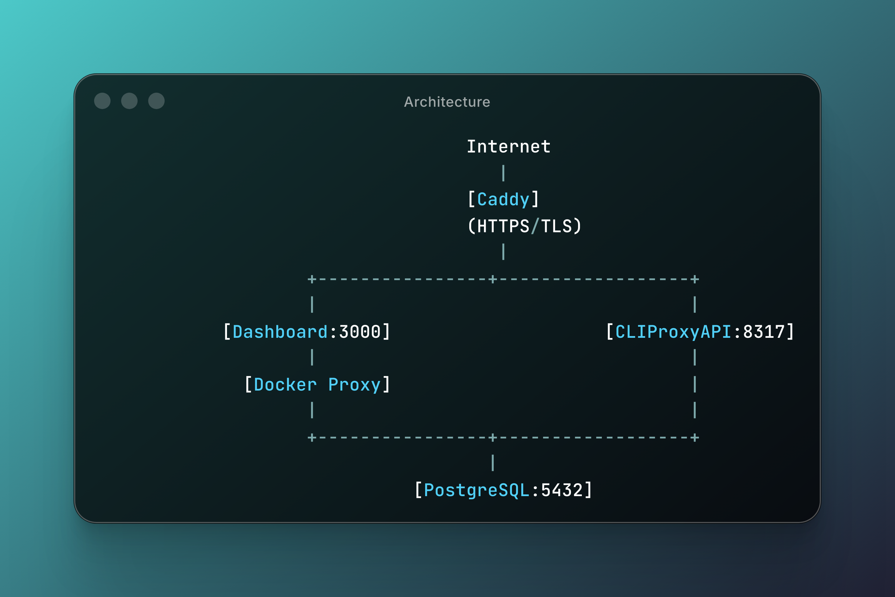
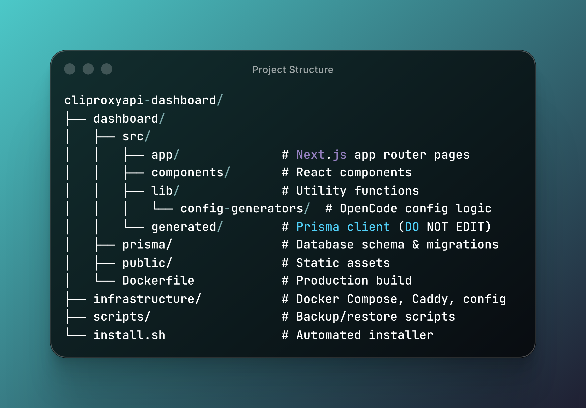

<p align="center">
  
</p>

<h1 align="center">CLIProxyAPI Dashboard</h1>

<p align="center">
  <strong>Claude Code, Gemini CLI ve Codex'i OpenAI uyumlu API'ler olarak kullanın — modern bir web kontrol paneliyle yönetin.</strong>
</p>

<p align="center">
  <a href="https://github.com/itsmylife44/cliproxyapi-dashboard/releases"></a>
  <a href="https://github.com/itsmylife44/cliproxyapi-dashboard/actions/workflows/release.yml"></a>
  <a href="https://github.com/itsmylife44/cliproxyapi-dashboard/pkgs/container/cliproxyapi-dashboard%2Fdashboard"></a>
  <a href="LICENSE"></a>
  <a href="https://discord.gg/7SrXxNueGA"></a>
  
  
  
</p>

<p align="center">
  <a href="README.md">English</a> | <a href="README.zh-CN.md">简体中文</a> | <b>Türkçe</b>
</p>

---

<p align="center">
  <a href="https://discord.gg/7SrXxNueGA">
    
  </a>
</p>
<p align="center">
  Bir Discord sunucumuz var — kurulum yardımı, sürüm duyuruları ve topluluk sohbeti.<br>
  <strong><a href="https://discord.gg/7SrXxNueGA">discord.gg/7SrXxNueGA</a></strong>
</p>

---

## Bu Nedir?

[CLIProxyAPI](https://github.com/router-for-me/CLIProxyAPI), OAuth tabanlı CLI araçlarını (Claude Code, Codex, Antigravity, Kimi, xAI, Devin ve daha fazlası; CLIProxyAPI eklentileri aracılığıyla Gemini CLI, GitHub Copilot, Kiro ve Cursor) **OpenAI uyumlu API'lere** dönüştürür. Bu kontrol paneli, YAML dosyalarına dokunmadan sağlayıcıları, API anahtarlarını, yapılandırmaları, günlükleri ve güncellemeleri yönetmeniz için bir web arayüzü sunar.

## Hızlı Başlangıç

> **Yerel kullanım (macOS/Windows/Linux)**: Yalnızca Docker Desktop gereklidir.

```bash
git clone https://github.com/itsmylife44/cliproxyapi-dashboard.git
cd cliproxyapi-dashboard
./setup-local.sh          # macOS/Linux
# .\setup-local.ps1       # Windows
```

Yerel kurulum betikleri, mevcut kaynak kodu değişikliklerinizin kullanılması için Docker Compose'u yerel bir kontrol paneli derlemesiyle (`--build`) başlatır.

**http://localhost:3000** adresini açın → yönetici hesabı oluşturun → tamamlandı.

> **Sunucu dağıtımı**: Tam [Kurulum Kılavuzu](docs/INSTALLATION.md)'na bakın. Zaten CLIProxyAPI çalıştırıyor musunuz? `sudo ./install.sh --dashboard-only` komutu, mevcut CLIProxyAPI kurulumunuzu yeniden kullanarak yalnızca kontrol panelini ve veritabanını kurar. Bu mod, kurulum kılavuzunda açıklandığı üzere kullanım toplama ve yedekleme zamanlama yardımcı servislerini de içerir.

## Özellikler

- **Görsel Yapılandırma** — YAML düzenlemeden yapılandırılmış formlar aracılığıyla CLIProxyAPI ayarlarını yönetin
- **Çoklu Sağlayıcı OAuth** — Claude Code, Codex, xAI (Grok), Antigravity, Kimi, Kimi.ai, Devin ve Meta AI hesaplarını bağlayın; CLIProxyAPI eklentileri etkinleştirildiğinde Gemini CLI, GitHub Copilot, Kiro ve Cursor da görünür
- **CLIProxyAPI Eklentileri** — CLIProxyAPI eklenti mağazasından (Ayarlar) eklentileri kurun, etkinleştirin, yapılandırın ve kaldırın; kalıcı eklenti birimi (volume) eksik olduğunda uyarı gösterir
- **Özel Sağlayıcılar** — Model eşlemeleriyle herhangi bir OpenAI uyumlu uç nokta (OpenRouter, Ollama vb.) ekleyin; yöneticiler bir sağlayıcıyı **Paylaşılan (Shared)** olarak işaretleyerek tüm ekip üyelerinin görmesini ve kullanmasını sağlayabilir
- **Perplexity Pro Sidecar** — Kurulum sırasında etkinleştirilen, Perplexity Pro aboneliği için isteğe bağlı OpenAI uyumlu sarmalayıcı
- **API Anahtarı Yönetimi** — Kullanıcı bazlı sahiplik ile API anahtarları oluşturun, iptal edin ve takip edin
- **Kullanıcı Yönetimi** — Yöneticiler kullanıcı oluşturabilir, düzenleyebilir, silebilir ve yönetici yetkisi verebilir
- **Gerçek Zamanlı İzleme** — Canlı günlük akışı, konteyner sağlığı ve servis yönetimi
- **Kota Takibi** — Sağlayıcı başına hız sınırları ve kullanım (Claude, model ve kod inceleme sınırları dahil Codex, Kimi, GitHub Copilot, Antigravity ve model bazında Gemini)
- **Telegram Kota Uyarıları** — OAuth kotası belirlenen eşiğin altına düştüğünde otomatik bildirimler (yapılandırılabilir sağlayıcılar, kontrol aralığı ve bekleme süresi)
- **Kullanım Analitiği** — İstek sayıları, sağlayıcı dağılımı, model istatistikleri, hata oranları, model ve sağlayıcı başına tahmini maliyet
- **Oh-My-Open-Agent Varyant Seçici** — Her ajan için model/beceri yapılandırmasıyla [oh-my-openagent](https://github.com/code-yeongyu/oh-my-openagent) (11 ajan + 9 kategori) ve [oh-my-opencode-slim](https://github.com/alvinunreal/oh-my-opencode-slim) (7 ajan, daha düşük token, yedek zincirler) arasında geçiş yapın
- **Yapılandırma Senkronizasyonu** — [`opencode-cliproxyapi-sync`](https://github.com/itsmylife44/opencode-cliproxyapi-sync) eklentisi aracılığıyla OpenCode yapılandırmalarını otomatik senkronize edin (slim yapılandırması dahil)
- **Yapılandırma Paylaşımı** — Paylaşım kodları (`XXXX-XXXX`) aracılığıyla model yapılandırmalarını başkalarıyla paylaşın
- **Tek Tıkla Güncellemeler** — Yönetici panelinden hem Dashboard'u (GHCR) hem de CLIProxyAPI'yi (Docker Hub) güncelleyin
- **Konteyner Yönetimi** — Konteynerleri doğrudan arayüzden başlatın, durdurun ve yeniden başlatın
- **Yedekleme ve Geri Yükleme** — Kontrol paneli yedekleri oluşturun, zamanlayın, yükleyin, önizleyin ve geri yükleyin (Ayarlar → Yedekleme)
- **Açık/Koyu Tema ve Diller** — Tema değiştirici; İngilizce, Almanca, İspanyolca ve Basitleştirilmiş Çince arayüz
- **Otomatik TLS** — Caddy aracılığıyla otomatik yenilenen Let's Encrypt sertifikaları

> Özelliklerin kullanılabilirliği dağıtım moduna bağlıdır. Yalnızca kontrol paneli (`--dashboard-only`) modunda CLIProxyAPI konteynerini yeniden başlatmak veya güncellemek için uyumlu Docker erişimi ve konteyner adlandırmasının ayrıca sağlanması gerekir; bkz. [Kurulum Kılavuzu](docs/INSTALLATION.md). Sürüm değiştirme ayrıca yazılabilir sürüm sabitleme yapılandırması gerektirir; bkz. [Ortam Değişkenleri Referansı](docs/ENV.md). Dashboard'u web arayüzünden güncellemek için bir dağıtım webhook servisi ve `DEPLOY_SECRET` gerekir; bkz. [Webhook / Dağıtım Yapılandırması](docs/CONFIGURATION.md#webhook--deploy-optional-for-cicd).

## Yerel Sağlayıcılar (Ollama / LM Studio / llama.cpp)

`localhost` veya özel ağlara işaret eden özel sağlayıcılar, barındırılan kurulumlardan kaynaklanabilecek SSRF saldırılarını önlemek amacıyla varsayılan olarak engellenir. Kendi barındırdığınız kurulumlarda bunları etkinleştirmek için:

1. `infrastructure/.env` dosyasında `ALLOW_LOCAL_PROVIDER_URLS=true` ayarını yapın.
2. Dashboard konteynerini yeniden başlatın (`docker compose up -d dashboard`).
3. Yerel temel URL ile bir özel sağlayıcı oluşturun (ör. Docker içinden Ollama için `http://host.docker.internal:11434/v1` veya kontrol paneli konteyner dışında çalışıyorsa `http://localhost:11434/v1`). API anahtarı alanı isteğe bağlıdır — sağlayıcı gerektirmiyorsa boş bırakın.

Bulut örneği meta veri adresleri (`169.254.169.254`, `100.100.100.200`) bu ayardan bağımsız olarak engelli kalır.

## Telegram Kota Uyarıları

OAuth sağlayıcı kotanız azaldığında Telegram üzerinden bildirim alın.

**Kurulum** (Kota → Telegram Uyarıları, yalnızca yöneticiler):

1. [@BotFather](https://t.me/BotFather) üzerinden bir Telegram botu oluşturun ve bot belirtecini (token) kopyalayın
2. Sohbet kimliğinizi (chat ID) alın (bota bir mesaj gönderin, ardından `https://api.telegram.org/bot<TOKEN>/getUpdates` adresini kontrol edin)
3. Kontrol panelinde **Kota** sayfasını açın, **Telegram Uyarıları** bölümüne kaydırın ve şunları girin:
   - Bot belirteci (Bot token)
   - Sohbet kimliği (Chat ID)
   - Kota eşiği (ör. kalan %20)
   - Kontrol aralığı ve bekleme süresi (dakika)
   - İzlenecek sağlayıcılar (Claude, Antigravity, Gemini CLI, Gemini, Codex, Copilot, Kimi)
4. Uyarıları etkinleştirin — zamanlayıcı varsayılan olarak her 5 dakikada bir kontrol eder ve bildirimler arasında 1 saatlik bekleme süresi uygular

Etkinleştirmeden önce yapılandırmanızı doğrulamak için **Test Gönder** düğmesini, hemen kontrol çalıştırmak için **Şimdi Kontrol Et** düğmesini kullanın.

Başarılı otomatik kota sıfırlamaları da yapılandırılan kota uyarı kanalı (Telegram veya Discord) üzerinden ayrı bir bildirim gönderir; varsa kalan sıfırlama kredilerini ve bir sonraki kredinin son kullanma tarihini içerir. Elle sıfırlamalar ve başarısız denemeler bu bildirimi göndermez.

## Oh-My-Open-Agent Entegrasyonu

Kontrol paneli iki OpenCode orkestrasyon varyantını destekler. **OpenCode ile Kullanım** bölümünden bunlar arasında geçiş yapabilirsiniz:

| Varyant | Ajanlar | Açıklama |
|---------|--------|-------------|
| **Oh-My-Open-Agent** | 11 ajan + 9 kategori | sisyphus, hephaestus, atlas, prometheus, oracle ve daha fazlasıyla tam özellikli orkestrasyon |
| **Oh-My-OpenCode Slim** | 7 ajan | Hafif: orchestrator, oracle, council, designer, explorer, librarian, fixer. Özel yedek zincirleriyle daha düşük token kullanımı |

Oluşturulan yapılandırmalar oh-my-openagent 5.1.33 ve oh-my-opencode-slim 3.0.4 sürümlerini hedefler ve yukarı akış şemalarına göre doğrulanır.

**Nasıl çalışır:**

1. Kontrol panelinde varyantınızı seçin — `opencode.json` içindeki eklenti otomatik olarak değişir
2. Ajanlara model atayın (kademeye göre otomatik atanır veya elle geçersiz kılınır)
3. Becerileri açıp kapatın (Slim'de ajan başına: simplify, codemap; Oh-My-Open-Agent'ta devre dışı bırakılan beceriler ve kancalar)
4. Yapılandırma, senkronizasyon eklentisi aracılığıyla otomatik olarak senkronize edilir

**İlk kurulum** (her varyant için bir kez çalıştırın):

```bash
bunx oh-my-openagent@latest install                  # Normal varyant
bunx oh-my-opencode-slim@latest install --no-tui     # Slim varyant
```

Her varyantın kendi yapılandırma dosyası vardır (`oh-my-openagent.json` / `oh-my-opencode-slim.jsonc`) — birbirleriyle çakışmazlar.

## Ekran Görüntüleri

<p align="center">
  
  <br><em>Kurulum Sihirbazı — rehberli ilk yapılandırma</em>
</p>

<p align="center">
  
  <br><em>Sağlayıcı Yapılandırması — API anahtarlarını ve OAuth hesaplarını yönetin</em>
</p>

<p align="center">
  
  <br><em>Kota Yönetimi — Telegram uyarılarıyla hız sınırlarını takip edin</em>
</p>

<p align="center">
  
  <br><em>Ayarlar — yapılandırma senkronizasyonu, sistem bilgisi ve güncellemeler</em>
</p>

## Mimari

İki ağ üzerinde (`frontend` ve internet erişimi olmayan `backend`) çalışan yedi Docker konteyneri ve isteğe bağlı Perplexity sidecar:

<p align="center">
  
</p>

| Servis | Görev |
|---------|------|
| **Caddy** | Ters proxy, otomatik TLS, HTTP/3 |
| **Dashboard** | Next.js web uygulaması, JWT kimlik doğrulama, socket proxy üzerinden Docker yönetimi |
| **CLIProxyAPI** | Yapay zeka proxy sunucusu, OAuth geri çağırmaları, yönetim API'si |
| **Perplexity Sidecar** | İsteğe bağlı (`perplexity` profili): Perplexity Pro aboneliği için OpenAI uyumlu sarmalayıcı |
| **Docker Socket Proxy** | Kısıtlı Docker API erişimi (yalnızca konteynerler, imajlar, ağlar) |
| **PostgreSQL** | Yalıtılmış dahili ağ üzerinde veritabanı |
| **Usage Collector** | Her 5 dakikada bir kullanım toplamayı tetikleyen cron konteyneri |
| **Backup Scheduler** | Zamanı gelen planlanmış yedeklemeleri çalıştıran cron konteyneri (her 5 dakikada bir kontrol eder) |

## Proje Yapısı

<p align="center">
  
</p>

## Teknoloji Yığını

| Bileşen | Teknoloji |
|-----------|-----------|
| Çatı (Framework) | Next.js 16 (App Router) |
| Arayüz (UI) | React 19 |
| Stil | Tailwind CSS v4 |
| Veritabanı | PostgreSQL 16 + Prisma 7 |
| Kimlik Doğrulama | JWT (jose) + bcrypt |
| Konteyner Yönetimi | Socket proxy üzerinden Docker CLI |

## Geliştirme

```bash
cd dashboard
./dev-local.sh              # Geliştirme ortamını başlat
./dev-local.sh --reset      # Veritabanını sıfırla
./dev-local.sh --down       # Konteynerleri durdur
```

Veya elle:

```bash
cd dashboard
npm install
cp .env.development .env.local  # Veritabanı kimlik bilgilerinizle düzenleyin
npx prisma migrate dev
npm run dev
```

Kontrol paneli `http://localhost:3000` adresinde çalışır.

### Yalnızca Arayüz Modu (veritabanı olmadan)

Kontrol paneli arayüzüne PostgreSQL veya oturum açma olmadan göz atmak için:

```bash
cd dashboard
SKIP_AUTH=1 npm run dev
```

Tüm rotaları sahte bir yönetici kullanıcısı olarak açar — temaları, düzenleri ve bileşenleri test etmek için kullanışlıdır.

## Dokümantasyon

| Kılavuz | Açıklama |
|-------|-------------|
| **[Kurulum](docs/INSTALLATION.md)** | Sunucu dağıtımı, yerel kurulum, elle kurulum |
| **[Yapılandırma](docs/CONFIGURATION.md)** | Ortam değişkenleri, config.yaml, yapılandırma senkronizasyonu |
| **[Ortam Değişkenleri](docs/ENV.md)** | Tam ortam değişkeni referansı |
| **[Kullanım Toplama](infrastructure/docs/USAGE_COLLECTION.md)** | Kullanım izleme servisi, sorun giderme, elle toplama |
| **[Sorun Giderme](docs/TROUBLESHOOTING.md)** | Yaygın sorunlar ve çözümleri |
| **[Güvenlik](docs/SECURITY.md)** | Üretim ortamı için en iyi uygulamalar |
| **[Yedekleme ve Geri Yükleme](docs/BACKUP.md)** | Otomatik ve elle yedeklemeler |
| **[Servis Yönetimi](docs/SERVICE-MANAGEMENT.md)** | Systemd ve Docker Compose komutları |
| **[Çalışma Kılavuzu (Runbook)](docs/RUNBOOK.md)** | Sağlık kontrolü, dağıtım, veritabanı, güncellemeler, izleme |

## Katkıda Bulunma

1. Fork → özellik dalı (feature branch) → PR
2. [Conventional Commits](https://www.conventionalcommits.org/) (`feat:`, `fix:`, `chore:`) kullanın
3. Göndermeden önce yerel olarak test edin

Release-Please, commit mesajlarından otomatik olarak sürüm oluşturur. Kurulum, betikler, kod stili ve PR kontrol listesi için [Katkı Kılavuzu](docs/CONTRIBUTING.md)'na bakın.

## Katkıda Bulunanlar

Bu harika insanlara teşekkürler ([emoji anahtarı](https://allcontributors.org/docs/en/emoji-key)):

<!-- ALL-CONTRIBUTORS-LIST:START - Do not remove or modify this section -->
<!-- prettier-ignore-start -->
<!-- markdownlint-disable -->
<table>
  <tbody>
    <tr>
      <td align="center" valign="top" width="14.28%"><a href="https://github.com/itsmylife44"><br /><sub><b>itsmylife44</b></sub></a><br /><a href="#code-itsmylife44" title="Code">💻</a> <a href="#doc-itsmylife44" title="Documentation">📖</a> <a href="#maintenance-itsmylife44" title="Maintenance">🚧</a> <a href="#infra-itsmylife44" title="Infrastructure">🚇</a></td>
      <td align="center" valign="top" width="14.28%"><a href="https://github.com/38lunin021189-creator"><br /><sub><b>Rizki Hidayat</b></sub></a><br /><a href="#code-38lunin021189-creator" title="Code">💻</a></td>
      <td align="center" valign="top" width="14.28%"><a href="https://github.com/dqphong0302"><br /><sub><b>Đặng Quốc Phong</b></sub></a><br /><a href="#code-dqphong0302" title="Code">💻</a></td>
      <td align="center" valign="top" width="14.28%"><a href="https://github.com/smart-tinker"><br /><sub><b>smart-tinker</b></sub></a><br /><a href="#code-smart-tinker" title="Code">💻</a> <a href="#bug-smart-tinker" title="Bug reports">🐛</a></td>
      <td align="center" valign="top" width="14.28%"><a href="https://github.com/islee23520"><br /><sub><b>islee</b></sub></a><br /><a href="#code-islee23520" title="Code">💻</a></td>
      <td align="center" valign="top" width="14.28%"><a href="https://github.com/deftdawg"><br /><sub><b>deftdawg</b></sub></a><br /><a href="#code-deftdawg" title="Code">💻</a> <a href="#bug-deftdawg" title="Bug reports">🐛</a></td>
      <td align="center" valign="top" width="14.28%"><a href="https://github.com/clcc2019"><br /><sub><b>dslife2025</b></sub></a><br /><a href="#code-clcc2019" title="Code">💻</a></td>
    </tr>
  </tbody>
</table>
<!-- markdownlint-restore -->
<!-- prettier-ignore-end -->
<!-- ALL-CONTRIBUTORS-LIST:END -->

## Dil Ekleme

Kontrol paneli çok dilli arayüzü destekler. Şu anda **İngilizce (en)**, **Almanca (de)**, **İspanyolca (es)** ve **Basitleştirilmiş Çince (zh-CN)** sunuyoruz. Ek diller için topluluk katkılarını memnuniyetle karşılıyoruz!

### Yeni bir dil nasıl eklenir

1. **İngilizce şablonu kopyalayın**:
   ```bash
   cp dashboard/messages/en.json dashboard/messages/{locale}.json
   ```
   `{locale}` yerine dil kodunu yazın (ör. Fransızca için `fr`, İspanyolca için `es`, Japonca için `ja`).

2. **Tüm dizeleri çevirin**:
   - Yeni dosyayı düzenleyicinizde açın
   - Her değeri çevirin (tüm anahtarları ve yapıyı değiştirmeden koruyun)
   - Örnek:
     ```json
     {
       "common": {
         "loading": "Wird geladen...",
         "cancel": "Abbrechen"
       }
     }
     ```

3. **Yeni yerel ayarı (locale) kaydedin**:
   - `dashboard/src/i18n/config.ts` dosyasını düzenleyin
   - Yerel ayarınızı `supportedLocales` dizisine ekleyin:
     ```ts
     export const supportedLocales = ["en", "de", "es", "zh-CN", "fr"] as const;
     ```
   - Görünen adı `localeNames` içine ekleyin:
     ```ts
     export const localeNames: Record<Locale, string> = {
       en: "English",
       de: "Deutsch",
       es: "Español",
       "zh-CN": "简体中文",
       fr: "Français",  // Bunu ekleyin
     };
     ```

4. **Yerel olarak test edin**:
   - `dashboard/` içinde `npm run dev` çalıştırın
   - Kontrol paneline giriş yapın
   - Kullanıcı Panelini (sağ üst) açın
   - Dil açılır menüsünden dilinizi seçin
   - Tüm arayüz dizelerinin dilinizde doğru görüntülendiğini doğrulayın

5. **PR gönderin**:
   - Başlık: `feat(i18n): add {language} translation`
   - Her iki dosyayı da ekleyin: `messages/{locale}.json` ve `src/i18n/config.ts` değişiklikleri
   - PR açıklaması: Harici çeviri kaynaklarına veya notlara bağlantı verin

### Çeviri Kalitesi Yönergeleri

- Çevirileri kısa tutun ve İngilizce sürümün tonuna uyun
- Resmi/iş ortamına uygun bir dil kullanın
- Arayüz öğelerinin çevirilerinizle taşmadığını veya bozulmadığını test edin
- Çoğullar ve cinsiyet (uygun olduğunda) hedef dil kurallarına uymalıdır
- Tarih/saat biçimlendirmesi `next-intl` tarafından yönetilir — değiştirmenize gerek yoktur
- Para birimi kodları İngilizce olarak korunur (ör. `USD`, `EUR`)

### Desteklenen yerel ayarlar

| Kod | Dil | Durum |
|------|----------|--------|
| `en` | İngilizce | ✓ Tamamlandı |
| `de` | Almanca | ✓ Tamamlandı |
| `es` | İspanyolca | Neredeyse tamamlandı |
| `zh-CN` | Basitleştirilmiş Çince | Neredeyse tamamlandı |

Yukarıdaki adımları izleyerek daha fazlasını ekleyin!

## Destek

- **[Discord](https://discord.gg/7SrXxNueGA)** — Topluluk sohbeti, kurulum yardımı, duyurular
- **[CLIProxyAPI](https://github.com/router-for-me/CLIProxyAPI)** — Çekirdek proxy dokümantasyonu
- **[Issues](https://github.com/itsmylife44/cliproxyapi-dashboard/issues)** — Hata bildirimleri ve özellik istekleri

## Yıldız Geçmişi

<a href="https://star-history.com/#itsmylife44/cliproxyapi-dashboard&Date">
  <picture>
    <source media="(prefers-color-scheme: dark)" srcset="https://api.star-history.com/svg?repos=itsmylife44/cliproxyapi-dashboard&type=Date&theme=dark" />
    <source media="(prefers-color-scheme: light)" srcset="https://api.star-history.com/svg?repos=itsmylife44/cliproxyapi-dashboard&type=Date" />
    
  </picture>
</a>

## Lisans

[MIT](LICENSE)

---

<p align="center">
  Next.js, React ve Tailwind CSS kullanılarak ❤️ ile geliştirildi
</p>
